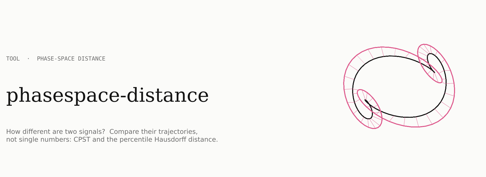
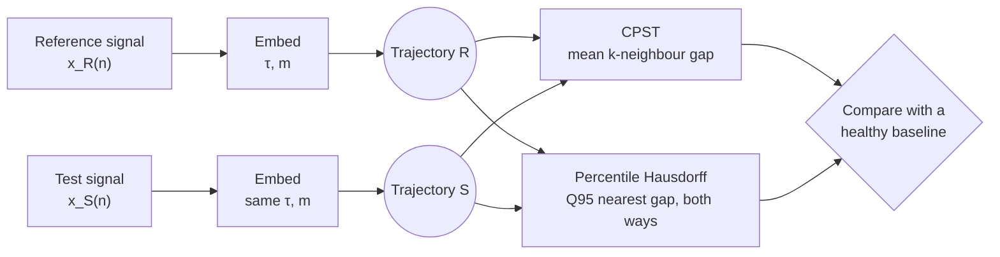
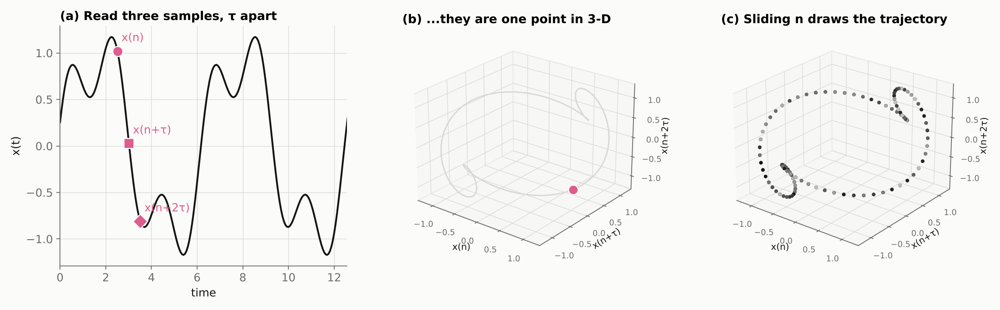
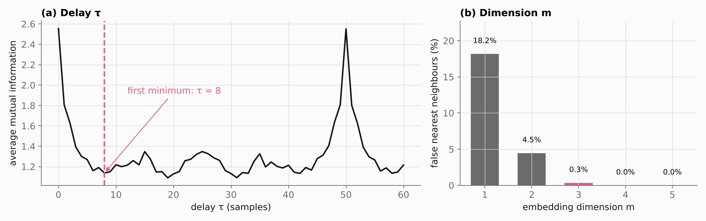
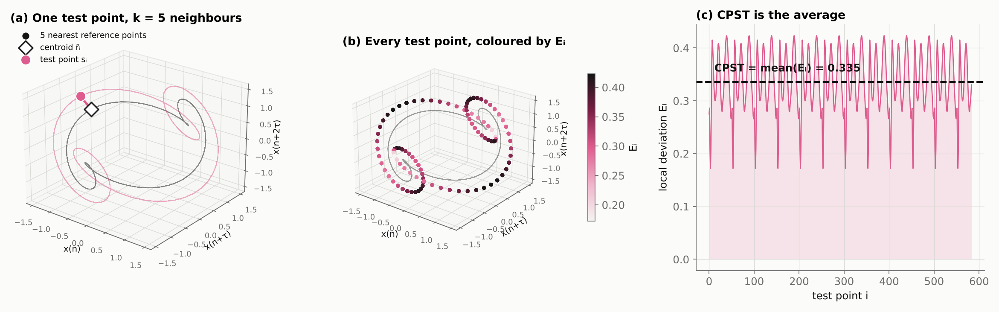
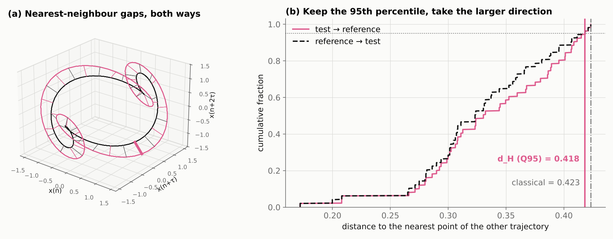
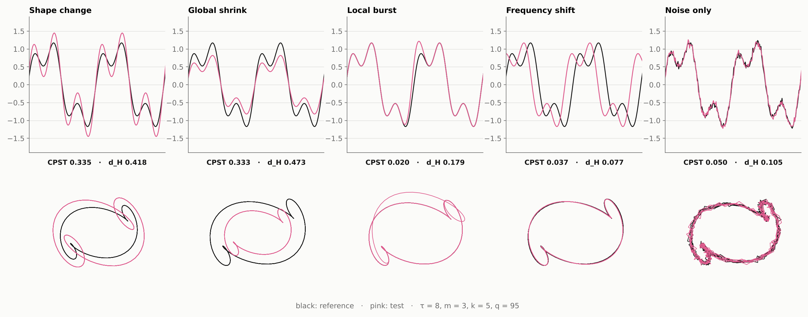
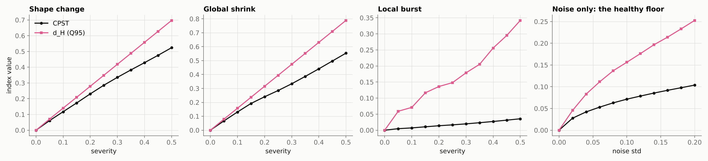
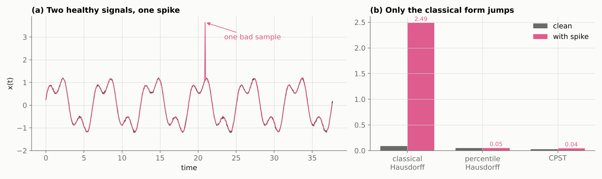
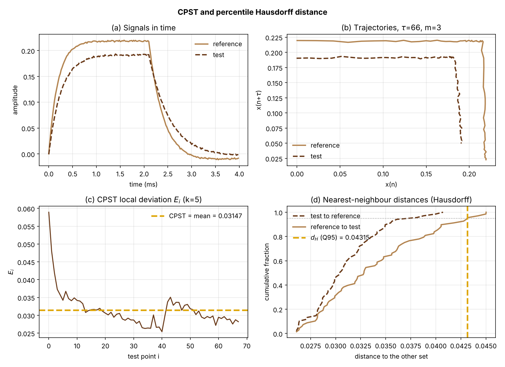

<p align="center">
  
</p>

<p align="center">
  <a href="https://nitipong.com/phasespace-distance"></a>
  
  
  <a href="LICENSE"></a>
  <a href="https://github.com/cnnitipong/phasespace-distance/actions/workflows/tests.yml"></a>
</p>

<p align="center">
  <b>How different are two signals?</b> Turn each one into a trajectory and measure the gap between the trajectories.<br>
  Two complementary indices: <b>CPST</b> (the average drift) and the <b>percentile Hausdorff distance</b> (the largest local gap).
</p>

<p align="center">
  <a href="https://nitipong.com/phasespace-distance"><b>Open the interactive demo</b></a> ·
  <a href="#quick-start">Quick start</a> ·
  <a href="#how-it-works">How it works</a> ·
  <a href="#gallery">Gallery</a> ·
  <a href="#api-reference">API</a> ·
  <a href="#citation">Citation</a>
</p>

---

## Contents

1. [Why phase space?](#why-phase-space)
2. [Quick start](#quick-start)
3. [How it works](#how-it-works)
   - [Step 1 · Embed the signal](#step-1--embed-the-signal)
   - [Step 2 · Choose τ and m](#step-2--choose-τ-and-m)
   - [Step 3 · CPST, the average drift](#step-3--cpst-the-average-drift)
   - [Step 4 · Percentile Hausdorff, the largest gap](#step-4--percentile-hausdorff-the-largest-gap)
4. [Gallery: five kinds of change](#gallery)
5. [CPST or Hausdorff?](#cpst-or-hausdorff)
6. [API reference](#api-reference)
7. [Command line](#command-line)
8. [Interactive web demo](#interactive-web-demo)
9. [Application: subsurface cracks under asphalt](#application-subsurface-cracks-under-asphalt)
10. [Practical guidance](#practical-guidance)
11. [Repository layout](#repository-layout)
12. [Citation](#citation)

---

## Why phase space?

A single feature, such as the peak or the decay time, reads one point of a waveform. Two signals can share that point and still differ everywhere else. Phase-space reconstruction keeps the whole shape: every sample and its delayed copies become a point, and the signal becomes a **trajectory**. Comparing trajectories compares the full dynamics of the two signals, in one number.

|  | Single feature (peak, rise, decay) | Phase-space distance (this package) |
|---|---|---|
| Uses | one value per record | every sample, in context |
| Sees | changes at that value only | changes anywhere in the waveform |
| Robust to one bad sample | depends | yes (k-neighbour averaging, 95th percentile) |
| Output | a feature to compare | a distance to a reference, in signal units |

## Quick start

```bash
git clone https://github.com/cnnitipong/phasespace-distance.git
cd phasespace-distance
pip install -r requirements.txt        # numpy, scipy, matplotlib
python -m pytest -q                     # 9 tests
```

```python
import psdist
from psdist.mock import make_pair

t, ref, test = make_pair("shape", severity=0.3)        # mock pair: the third harmonic grows

psdist.cpst(ref, test, tau=8, m=3, k=5)                 # 0.335  average drift
psdist.hausdorff(ref, test, tau=8, m=3, q=95)           # 0.418  largest local gap (95th percentile)
psdist.compare(ref, test, tau=8)                        # both, plus the classical Hausdorff distance
```

Your own data: load two 1-D arrays of the same length and sampling rate and call the same functions.

## How it works



### Step 1 · Embed the signal

Takens' delay embedding reads the signal at three instants one delay apart and treats them as one point in 3-D:

$$
\mathbf{X}(n) = \big[\,x(n),\; x(n+\tau),\; x(n+2\tau),\; \dots,\; x(n+(m-1)\tau)\,\big], \qquad n = 1,\dots,N-(m-1)\tau
$$

<p align="center"></p>

### Step 2 · Choose τ and m

- **Delay τ**: the first minimum of the average mutual information, where $x(n+\tau)$ starts to bring new information.
- **Dimension m**: the smallest $m$ for which false nearest neighbours vanish, so the trajectory no longer crosses itself.

Both signals must use **the same** τ and m.

<p align="center"></p>

### Step 3 · CPST, the average drift

For each test point $\mathbf{s}_i$, find its $k$ nearest reference points $\mathcal{N}_k(\mathbf{s}_i)$, average them into a centroid and measure the gap:

$$
\bar{\mathbf{r}}_i = \frac{1}{k}\sum_{j\in\mathcal{N}_k(\mathbf{s}_i)} \mathbf{r}_j, \qquad
E_i = \big\lVert \mathbf{s}_i - \bar{\mathbf{r}}_i \big\rVert, \qquad
\mathrm{CPST} = \frac{1}{N_f}\sum_{i=1}^{N_f} E_i
$$

Averaging $k$ neighbours (Chelidze and Liu, 2006) steadies the index against noise. CPST was introduced for vibration-based damage detection by Nie et al. (2013).

<p align="center"></p>

### Step 4 · Percentile Hausdorff, the largest gap

Every point finds its nearest neighbour on the other trajectory, in both directions. The classical Hausdorff distance keeps the single worst gap; the percentile version keeps the $q$-th percentile ($q = 95$), so one bad sample cannot decide the result:

$$
d_H(\mathbf{R},\mathbf{S}) = \max\Big\{\, Q_{q}\big(\min_j \lVert \mathbf{s}_i - \mathbf{r}_j \rVert\big),\; Q_{q}\big(\min_i \lVert \mathbf{r}_j - \mathbf{s}_i \rVert\big) \Big\}
$$

<p align="center"></p>

## Gallery

The mock base signal $x(t) = \sin t + 0.45\sin(3t + 0.6)$ draws a clean knot in phase space, so each kind of change is easy to see. Black: reference. Pink: test.

<p align="center"></p>

How each index grows with the size of the change, and the floor that noise alone produces:

<p align="center"></p>

Why the percentile matters: one spike on a healthy record makes the classical Hausdorff distance jump, while the percentile version and CPST barely move.

<p align="center"></p>

## CPST or Hausdorff?

| | CPST | Percentile Hausdorff |
|---|---|---|
| Question | How far, on average, is the test from the reference flow? | How large is the biggest gap between the trajectories? |
| Neighbours | $k$ reference points, averaged into a centroid | 1 nearest point, in both directions |
| Summary statistic | mean of all local deviations $E_i$ | $q$-th percentile, larger direction |
| Most sensitive to | spread-out, systematic distortion | localised excursions on part of the orbit |
| Identical signals | small positive floor when $k>1$ | exactly zero |
| Classical special case | $k = 1$ | $q = 100$ |

A useful reading: when $d_H / \mathrm{CPST}$ is large, the change is **localised**; when the two are similar, it is **spread out**. Use both.

## API reference

| Function | Returns |
|---|---|
| `embed(x, tau, m)` | `(N-(m-1)τ, m)` array of trajectory points |
| `average_mutual_information(x, max_lag, bins=16)` | AMI for lags `0..max_lag` |
| `first_minimum(curve, smooth=1)` | index of the first (optionally smoothed) local minimum |
| `false_nearest_neighbours(x, tau, max_m=6, rtol=10)` | false-neighbour fraction for `m = 1..max_m` |
| `cpst(ref, test, tau, m, k=5, return_details=False)` | CPST; with details: `E`, `centroids`, `neighbours`, `R`, `S` |
| `hausdorff(ref, test, tau, m, q=95, return_details=False)` | $d_H$; with details: both distance lists, nearest indices, `h_sr`, `h_rs` |
| `compare(ref, test, tau, m=3, k=5, q=95)` | dict with `cpst`, `hausdorff_q`, `hausdorff_classical` |
| `psdist.plotting.plot_comparison(ref, test, tau, ...)` | four-panel figure and the two values |
| `psdist.mock.make_pair(kind, severity, noise, n, seed)` | mock `(t, ref, test)`; kinds: `shape`, `global`, `local`, `frequency`, `noise` |

`cpst` and `hausdorff` accept raw 1-D signals (embedded internally) or trajectories you embedded yourself.

## Command line

```bash
python examples/compare_two_signals.py                              # built-in PECT-like demo pair
python examples/compare_two_signals.py ref.csv test.csv --tau 64 --m 3 --k 5 --q 95
python examples/make_readme_figures.py                              # regenerate docs/figures
```

CSV: one column (amplitude) or two (time, amplitude), header row optional. Without `--tau`, the delay is the first minimum of the mutual information of the reference.

<p align="center"></p>

## Interactive web demo

**[nitipong.com/phasespace-distance](https://nitipong.com/phasespace-distance)** runs the same algorithm in the browser (`web/index.html`, one self-contained file):

- pick a mock change or upload two CSV files;
- set τ (or let the mutual information choose it), m, k and q;
- watch the embedding, the CPST neighbourhood of any test point and the Hausdorff gaps in rotatable 3-D;
- download the results as JSON or CSV.

The JavaScript port reproduces the Python values to four significant figures. To host it yourself, copy `web/index.html` to any static host; see [`docs/DEPLOY.md`](docs/DEPLOY.md).

## Application: subsurface cracks under asphalt

The package was written for pulsed eddy current testing (PECT) of orthotropic steel bridge decks, where root-deck fatigue cracks hide under the asphalt wearing course. A defect-free record is the reference; records along a scan line are the tests. On the bench-scale experiment (12 mm plate, cut-through crack, lift-off 0 mm, τ = 64, m = 3, k = 5, q = 95):

| Record | CPST (mV) | $d_H$ (mV) |
|---|---|---|
| defect-free, x = −100 mm | 2.6 | 3.4 |
| above the crack, x = 0 mm | 30.4 | 43.2 |

Across eleven lift-offs up to 120 mm, the percentile Hausdorff distance ranked first and CPST second among eight damage indices, in both the experiment and a finite-element model.

## Practical guidance

- **Same τ, m, length and sampling rate** for both signals.
- **Keep the amplitude.** Do not normalise each signal on its own if an amplitude change is part of what you want to detect.
- **Compare with a healthy baseline**, not with zero: CPST has a floor when $k>1$ and noise raises both indices (see the gallery).
- **Choose the reference carefully.** In the lab, a record far from the defect; in the field, an independent library of defect-free records or a model reference.
- **Defaults** $k = 5$, $q = 95$ worked for PECT. $k = 1$ and $q = 100$ recover the classical forms.
- **Cost** is $O(N^2 m)$ with a k-d tree in Python; a few thousand points take well under a second.

## Repository layout

```
phasespace-distance/
├── psdist/
│   ├── core.py               embedding, AMI, FNN, CPST, Hausdorff
│   ├── plotting.py           four-panel comparison figure
│   └── mock.py               mock signal pairs used in the docs and the web demo
├── examples/
│   ├── compare_two_signals.py   CLI and PECT-like demo
│   ├── make_readme_figures.py   regenerates docs/figures
│   └── data/                    reference.csv, test.csv
├── web/index.html            interactive demo (self-contained)
├── docs/figures/             README figures
├── docs/DEPLOY.md            hosting the demo
├── tests/test_core.py        unit tests
└── .github/workflows/        tests and GitHub Pages
```

## Citation

If you use this code, please cite:

```bibtex
@unpublished{praphaphankul2026pect,
  author = {Praphaphankul, Nitipong and Akutsu, Ayako and Sasaki, Eiichi},
  title  = {Subsurface crack detection in asphalt-paved orthotropic steel bridge decks
            using pulsed eddy current testing and phase-space feature analysis},
  note   = {Manuscript in preparation},
  year   = {2026}
}

@article{praphaphankul2024numerical,
  author  = {Praphaphankul, Nitipong and Akutsu, Ayako and Sasaki, Eiichi},
  title   = {Numerical study of phase space analysis for the development of subsurface
             crack detection method using pulsed eddy current},
  journal = {Structure and Infrastructure Engineering},
  year    = {2024},
  doi     = {10.1080/15732479.2024.2413637}
}
```

**Background.** Nie, Hao and Ma (2013), *J. Sound Vib.* 332(4), 1061–1078 (CPST) · Chelidze and Liu (2006), *Nonlinear Dyn.* 46, 61–72 (k-neighbour averaging) · Takens (1981), delay embedding · Fraser and Swinney (1986), mutual information · Kennel, Brown and Abarbanel (1992), false nearest neighbours.

## Licence

MIT © 2026 [Nitipong Praphaphankul](https://nitipong.com), Department of Architecture, Chulalongkorn University.
